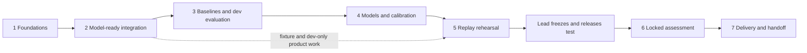

# Phased delivery plan

Execution plan requested by the project lead on 31 October 2026. [WORK_PLAN.md](WORK_PLAN.md) defines people, file ownership and the verified starting state. This document makes later work actionable; proposed defaults below are not approvals of unresolved scientific choices.

The existing build order is detailed for Phase 1, but model-ready integration is still unfinished. Phase 1 completion does not imply model accuracy or end-to-end readiness. Each task below should become a small implementation PR with its evidence, rather than a single large phase-sized change.

## 1. Route, priorities and invariant rules



The critical path is agreed availability/cohort contracts → joined snapshots and labels → trusted baseline/evaluator → selected/calibrated candidate → approved locked release. Product fixtures and independent agent tasks can run in parallel. A missing optional operational feed must not stop a weather-plus-schedule variant.

- Time partitions and horizons come from `configs/experiment.yaml`: train 2023, validation H1 2024, calibration H2 2024, final test January–July 2025; horizons 3/6/9/12 h.
- Select model features/hyperparameters using development data only. Use calibration data under a prespecified protocol; never use 2025 to choose a model, threshold, feature or exclusion policy.
- Labels and realised weather slices stay outside inference inputs. Request population, schedule demand and feature selection must not depend on final cancellation/diversion/delay values.
- Report arrival throughput (AAR proxy), conditional severe delay and cancellation with their own meanings and denominators. Capacity ratio is an additional experimental outcome.
- Preserve all in-scope prediction rows, including `unavailable` rows with reasons. Every comparison must expose eligibility, exclusions, prediction coverage and common support.
- A required dependency blocks only the task using it. Continue fixtures, interface implementation and other cleared experiment variants.

## 2. Lead decisions and dependencies

P10, P12, WP-D3 and WP-D4 are accepted in [DECISIONS.md](DECISIONS.md). Do not reopen them as unapproved prerequisites. The table distinguishes accepted interfaces from the remaining decisions required before dependent work is released; planning an option does not accept it.

| Plan decision | What must be fixed | Blocks | Safe work before approval |
|---|---|---|---|
| WP-D1: label release | Timestamp/latency rule for when archived outcomes are assumed known; how unknown availability is handled; model-fit cutoff enforcement | Real model and label-derived baseline/reference fitting | Fixture implementation, hashes/joins, schedule-only audits |
| WP-D2: clock tolerance | Approve or revise the proposed ±2 min duration/clock tolerance and version any change | Outcome snapshot used for real fitting and final release | Existing quarantine/coverage reporting and fixtures |
| WP-D3: cohort meaning | Accepted by the lead: versioned CSV-only and LOAO memberships and airport-role manifests; see DATA_CONTRACTS §6 | Consumer-side training/scoring selection still required | Implement and stage approved cohorts; rebuild dependent snapshots |
| WP-D4: ratio labels | Accepted by the lead: primary ratio labels and missing/nonpositive-reference detail mapping; see DATA_CONTRACTS §7 | Downstream baseline/model support still required | Stage approved ratio labels with frozen reference |
| WP-D5: operational feed | Simulated availability latency, valid source-hour coverage and freshness for lagged operations | Operations-context features and persistence eligibility | Weather-plus-schedule variant; feed fixtures |
| WP-D6: transfer comparator | Source-airport schedule-only regression and target-airport persistence proposal; target calibration prohibited for strict zero-shot | Comparable LOAO reports | Source-only training fixtures and membership guards |
| WP-D7: calibration/alerts | Calibration family and time allocation, alert threshold objective/budget, episode matching and sparse fallback validation criteria | Final calibrators, recommendations, alert metrics | Candidate APIs, dev-only curves and UI fixtures |

The default first model-fit cutoff is **2024-01-01T00:00:00Z**, matching the reviewed baseline scope. Every run must nevertheless declare and validate its actual cutoff. A train+validation refit is a separate lead-approved experiment with a later cutoff and new evaluation scope; it cannot be compared in-sample on validation.

WP-D1 applies to label-derived preprocessing as well as model weights. The existing P10 reference uses complete 2023 archive outcomes. If the chosen release simulation makes some of those outcomes unavailable at the fit cutoff, Agent 1 must rebuild the reference from the eligible training subset, or the lead must approve a different declared fitting protocol. Do not silently grant the normalizer earlier availability than its source outcomes.

## 3. Phase 1 — verify the foundations already built

**Purpose:** keep a reliable starting point instead of rebuilding completed modules. Inputs are the approved source files and raw manifest. Ownership and current merge evidence are in `WORK_PLAN.md`.

| Owner | Completion evidence to retain |
|---|---|
| Agent 1 | Reproducible flights, primary requests, hourly outcomes, labels and P10 hourly ratios; timestamp/source/CSV-match audits; P12 exclusion counts; stable producer manifests |
| Agent 2 | Weather source/latency policies; request-keyed weather snapshots for both tasks at each request's own issue time; normalized lineage joins; temporal and file-read-boundary tests |
| Agent 3 | PR #2 implementation/review history and fixture evidence; any reviewer development smoke report is labelled as such |
| Lead/reviewer | Accepted decision records and which exact producer commits/artifact hashes form the starting snapshot |

**G1 exit:** merged producers regenerate with matching source scope and explicit unknowns; completed work and integration gaps are distinguished. Do not describe the existing weather snapshot writer as absent. Do not describe the merged evaluator PR as a fully accepted G3 gate without the required audit and development-report evidence.

## 4. Phase 2 — make the datasets ready for each experiment

**Entry:** G1 for the relevant producer. **Outputs:** versioned requests, labels, snapshots/lineage, registry, manifests, evaluation slices and a dataset readiness report.

### Agent 1: requests, labels and source scope

| Task | Work | Acceptance evidence |
|---|---|---|
| 2-A1a | Freeze the WP-D3 cohort interface, then implement `csv_only_v1` and one `loao_<ICAO>_v1` per study airport in `requests.py` | Only `requests.py` builds prediction IDs; deterministic IDs differ by cohort; membership is outcome-independent; date/horizon bounds and manifests are tested |
| 2-A1b | Emit matching labels for every new cohort; extend the ratio-label contract under WP-D4 | Cardinalities reconcile per task/target/cohort/horizon; cancellations remain excluded from conditional delay; exact allowed reason/detail mapping; evaluator accepts the version |
| 2-A1c | Freeze stable dataset manifest fields and incorporate WP-D1/D2 decisions | `parquet_sha256`, `rows`, `data_mode`, schema/producer versions and source hashes remain stable; downstream hashes match; label availability and normalizer fitting use the same accepted cutoff policy |
| 2-A1d | Investigate the reported 2025 ATL volume change using schedule fields only | Report scheduled counts per airport/direction/month, source-day coverage and carrier scope; compare like calendar periods; mutate outcomes without changing the report; call it drift/coverage analysis, with no model tuning or test-error inspection |

Approved cohort semantics for WP-D3:

- `retrospective_schedule_v1`: primary reporting-carrier experiment; keep its existing IDs stable.
- `csv_only_v1`: severe-delay task only, with the paired cancellation outcome declared explicitly; no CSV-derived hourly throughput. A true CSV-only model uses sample-member rows in each fit/tune/calibration/score partition. An all-BTS model scored on the CSV subset is a different, clearly named paired analysis; do not conflate them.
- `loao_<ICAO>_v1`: tags the entire transfer experiment, with explicit source/fitting airports and held-out/scoring airport. The proposed request dataset includes the rows needed for both roles; the scoring selection contains only the held-out airport. Freeze this membership before emitting IDs.
- For strict zero-shot LOAO, omit the capacity-ratio comparison unless the lead approves a reference that does not fit on held-out-airport outcomes. The current all-airport P10 reference uses held-out-airport training outcomes and therefore cannot silently be reused as a zero-shot normalizer.

For WP-D4, explicitly version the allowed `target_kind` and any extra missing/nonpositive-reference detail values. Keep the settled canonical exclusion categories and null-if-eligible rule. An unknown detail remains a hard error; adding a ratio column to hourly outcomes alone does not add a label contract.

### Agent 2: complete and verify model inputs

| Task | Work | Acceptance evidence |
|---|---|---|
| 2-A2a | Verify the merged weather snapshot pipeline, then cover all new request cohorts | Exactly one snapshot per prediction ID, no orphans/duplicates; every row uses its exact `as_of_utc`, including off-hour flights; lineage joins through `(snapshot_key, feature_group)` |
| 2-A2b | Add schedule/calendar demand through an explicit column projection | Read only keys and approved `scheduled_*` fields under the retrospective schedule assumption; changing cancellations, diversions, actual times or delays leaves schedule features unchanged |
| 2-A2c | Add lagged operations only behind WP-D5 and a separate timestamped simulated feed | Contributor event/source-hour end and availability are both ≤ issue time; no incomplete current-hour totals; stale/partial source flags propagate; unknown availability is not treated as measured |
| 2-A2d | Extend the feature registry and dataset manifests to the model contract | Type, unit, source, transformation/version, missing policy and serving support per feature; source ages and hashes; table data modes agree; registry/schema can be frozen and round-tripped |
| 2-A2e | Write a separate target-hour weather-slice table for evaluation | Thunderstorm and IFR definitions, source IDs and coverage documented; one unambiguous airport/hour key; access tests prove this table cannot become a predictor |

Preserve the current weather reader's file-open guard. A demand integration PR must deliberately extend the read-boundary contract and tests for named schedule projections. An operations loader has its own allowed inputs and availability policy; do not weaken the guard to permit arbitrary outcome-table reads.

Reuse observation calculations per `(airport, exact issue time)` where possible, but forecast selection also depends on the target window. Do not reuse one target's TAF state across different future windows or round flight issue times down to an hour. Cache physical snapshots across cohorts while retaining separate prediction IDs.

Evaluate a weather-plus-schedule variant even if simulated operations are added. Test a change to data after T, the target flight's own outcomes, later-in-hour reports and post-T corrections/amendments. These changes must leave earlier eligible snapshots unchanged.

### Agent 3: stabilize the evaluator while data integration proceeds

| Task | Work | Acceptance evidence |
|---|---|---|
| 2-A3a | Verify merged PR #2 fixes against its review findings; close any remaining gaps | Fixed ledger independent of `--reports`; experiment/content binding and duplicate-prediction-hash refusal; run-manifest fit cutoff checked; common support correct for pooled/all-horizon slices; main-level mode/row tests |
| 2-A3b | Verify and complete the reviewed robustness work | Request hash bound to baseline manifest; source-partial provenance visible; fallback marked degraded only after development validation; avoid duplicate hourly loads; exact score-row equality enforced |

Request a new-head leakage audit through the lead/reviewer after fixes. Reproduce the directory-change, experiment-relabel, later-fit-cutoff, pooled-support and main-level mutation probes. Record unresolved findings with severity and owner. Do not infer acceptance from a previous audit, fixture count, or a reviewer smoke run.

**G2 exit, per named experiment:** request/label/feature cardinalities and keys agree; registry and manifests validate; required lead choices are recorded; temporal mutations pass; fit eligibility is enforceable. Primary weather-plus-schedule readiness can pass independently of optional operations features. CSV/LOAO readiness is tracked separately and is required before their own runs or the final declared experiment batch.

## 5. Phase 3 — establish baselines and trusted development metrics

**Entry:** G2 for the experiment plus an accepted current-head evaluator audit. Fixtures and baseline implementation can begin earlier. **Data:** 2023/2024 only in model-development readers.

| Owner / task | Work | Deliverable / check |
|---|---|---|
| Agent 3 / 3-A3a | Finish throughput persistence, seasonal persistence, climatology and schedule-only; add `baseline_conditional_rate_v1`, `baseline_logistic_v1` and a separate cancellation baseline | Train-only fitted statistics, declared smoothing and missing/rare-category handling; probabilities valid; source/fit bounds recorded |
| Agent 3 / 3-A3b | Add ratio baselines once ratio labels are approved, and the WP-D6 transfer comparator | Frozen training reference reused; no held-out calibration, category fitting or target-airport climatology in strict LOAO |
| Agent 1 / 3-A1a | Reconcile evaluator denominators and label exclusions | Counts by airport/month/split/cohort/horizon; P12 partial-but-eligible hours stay eligible; cancellations are not negative delay examples |
| Agent 2 / 3-A2a | Supply registry, source-age/missingness summaries and evaluation weather slices | Every metric slice is traceable; no evaluation-only weather is loaded into feature generation |
| Agent 3 / 3-A3c | Reproduce real development reports from saved predictions and labels | `artifacts/<run_id>/predictions.parquet`, run manifest, metrics and figures; every required model/baseline compares on a declared common row set |

With the initial January 2024 fit cutoff, 2023 supplies fitting data; it is not an out-of-sample forecast score period for that fitted run. Any training diagnostics are labelled in-sample and kept separate. The validation/calibration forecasts obey the same issue-time cutoff in candidate and baseline runs.

Required reporting: per-airport/horizon/cohort RMSE/MAE/bias for throughput; PR-AUC/average precision, recall-at-precision/precision–recall summaries, prevalence, Brier and reliability for binary targets; cancellation denominator; prediction coverage/abstention; severe-weather and missing-source slices. Undefined metrics are null with reasons.

Apply the approved PR #2 aggregation rules when merged: headline per-airport results; label airport-hour-weighted pooling explicitly; use the approved 08:00 UTC day-block anchor and declared bootstrap procedure. Do not label airport-hour weighting as flight-volume weighting. Lead with climatology/seasonal comparators where ordinary persistence is weak at long horizons; still show every required baseline.

**G3 exit (per named experiment):** reproducible development baseline report; source/hash/mode checks exercised against real inputs; required targets/cohorts represented; coverage failures visible; reviewer accepts the evaluator and its exact audit evidence. No requirement to invent a positive skill result.

## 6. Phase 4 — train, calibrate and test robustness on development data

**Entry:** G3 and the experiment's accepted availability policy. **Outputs:** candidate bundles, development predictions, calibration artifacts, attribution companion and frozen selection record.

| Owner / task | Work | Deliverable / check |
|---|---|---|
| Agent 3 / 4-A3a | Implement `train.py` with shared model/feature/label contracts | One versioned model bundle per target/cohort; airport categorical; all learned preprocessing and feature selection fitted on eligible training rows only |
| Agent 3 / 4-A3b | Fit LightGBM candidates on 2023, early-stop/select using H1 2024 | Point and p10/p90 regression heads; conditional-delay and cancellation probability models; fixed search budget and selection rationale in the run manifest |
| Agent 3 / 4-A3c | Freeze the candidate family, then calibrate using H2 2024 under WP-D7 | Calibrators, interval policy and alert thresholds are saved; no hyperparameter search against calibration or test results |
| Agent 3 / 4-A3d | Run prespecified ablations and source-only transfer experiments | Schedule/calendar → observations → forecasts → runway components → optional simulated operations; primary/CSV/LOAO results remain separate |
| Agent 1 / 4-A1a | Verify cohort and outcome/reference fit membership | No source release after the run's fit cutoff; all horizons of a flight share a target-date split; no held-out labels enter a LOAO normalizer |
| Agent 2 / 4-A2a | Verify feature/registry and inference compatibility | Unknown airport/category and missing-weather fixtures; stale and partial statuses propagate; frozen feature order/types and availability rules reproduced |
| Lead/reviewer / 4-R | Review candidate selection, temporal tests and leakage audit | Exact candidate commit and artifact hashes; findings resolved or an explicitly scoped limitation accepted |

Every run records `fit_cutoff_utc`, training and scoring airports, feature/label/cohort versions, model parameters, source hashes, calibration interval and data mode. Refuse in-sample comparisons against a baseline with a different effective cutoff. Predictions cover every in-scope request (target in the scored split and issue time at/after cutoff), including explicit unavailable rows.

Reserve separate chronological calibration-fit and operating-threshold assessment data, or a lead-approved equivalent such as cross-fitting. If the same calibration rows fit a calibrator and are used for a displayed diagnostic, label that diagnostic honestly. Do not describe it as an independent final assessment. Freeze exact dates before inspecting the relevant results.

Strict LOAO fits categories/statistics, smoothing, weights and calibrators on the source airport only. Target-airport observations known at issue time may be inference inputs under the declared feed; target-airport outcomes may not fit a comparator, reference or calibrator. Evaluate source-trained schedule-only and persistence under WP-D6. Any target-domain adaptation is a separate experiment.

**G4 exit:** lead selects the candidate or a validated baseline fallback using development evidence; freezes cohort matrix, feature registry, model bundles, calibrators, reference/latency/exclusion policies, metrics and thresholds. Poor improvement is reported rather than hidden. 2025 remains unused for selection.

## 7. Phase 5 — build and rehearse the replay product

**Entry:** fixtures can start during Phase 2; real rehearsal uses development artifacts and progressively frozen G4 candidates. **Outputs:** code-driven recommendations, evidence-grounded text, dashboard, replay fixtures and a rehearsal checklist.

| Owner / task | Work | Acceptance evidence |
|---|---|---|
| Agent 3 / 5-A3a | Implement `recommend.py` against frozen thresholds and eligible predictions | Structured recommendations come from code; severe delay is conditional on operating; cancellation reported separately; unavailable inputs produce an explicit abstention |
| Agent 3 / 5-A3b | Implement `explain.py` from predictions, timestamps and SHAP companion | Numerical facts remain exact; drivers described as associations; citations identify data/feature times; insufficient-data and LLM-failure paths work |
| Agent 3 / 5-A3c | Build `app/dashboard.py` for airport/time/horizon replay | Show prediction, uncertainty, source age, exclusions, data mode and simulated-feed assumptions; read saved metrics; no retraining or metric recomputation in the UI |
| Agent 2 / 5-A2a | Reproduce pinned snapshots through offline and replay/inference paths | Same contributors, values, time windows and versions; test missing METAR/TAF, supersession, stale reports and off-hour requests |
| Agent 1 / 5-A1a | Validate request/outcome joins and disclosure boundaries | Separate outcome reveal; no labels in inference payloads; denominator/coverage and cancellation meaning stay visible |
| Lead / 5-R | Rehearse the coordinator's workflow and failure stories | Usable normal, adverse-weather and insufficient-data scenarios; claims and assumptions understandable without reading code |

Freeze any serving/JSON interface before connecting the UI. A live service or cloud deployment is optional separate scope; historical replay is the required product. Validate the actual fallback on development rows before assigning `degraded`; an arbitrary fill or an untested fallback is not validated behavior.

A recall-at-precision curve summary is not a chosen operating threshold. Alert episode rules (onset/offset, merge gap, match window, alert burden and units) and operating thresholds are fixed under WP-D7 from the declared development/calibration protocol. Use a development selection rule for showcase cases; final worst misses are selected by the frozen evaluator after Phase 6. No dashboard work grants access to locked 2025 outcomes for development.

**G5 exit:** fixture/development rehearsal passes, offline/replay feature parity is demonstrated, numerical and explanation paths agree, missing-input behavior is visible, and the lead approves the user-facing language. A safe cached replay works without network access.

## 8. Phase 6 — perform the approved locked assessment

**Entry:** G4 and G5, accepted evaluator audit, all declared cohort contracts ready, and explicit lead approval for this exact test-release batch. **Period:** 2025-01-01 through 2025-08-01 exclusive.

| Owner / task | Work | Acceptance evidence |
|---|---|---|
| Lead / 6-Ra | Sign off the frozen experiment matrix | Primary, CSV-only and both LOAO directions, their true memberships/training airports, candidate/baselines, model/data/config hashes, thresholds, fit cutoffs and metric definitions |
| Agent 1 / 6-A1a | Verify final data and label provenance before release | Source scope, row counts, exclusions and approved reference/release policy; no changed cohort populations after selection |
| Agent 2 / 6-A2a | Verify frozen feature generation and contributor bounds | No post-issue input reaches any scored snapshot; registry and feature hashes match the candidate |
| Agent 3 / 6-A3a | Claim the run before reading test outcome values, then generate and score saved outputs | Canonical fixed ledger, atomic claim, experiment/content binding and canonical prediction-content hash; output-directory changes or experiment renaming cannot create a second assessment |
| Agent 3 / 6-A3b | Produce the final report and prespecified failure cases | Per-airport/horizon/cohort metrics versus baselines, uncertainty/calibration, weather/missingness slices, exclusion bias, alert metrics and three worst misses with traceable explanations |
| Lead/reviewer / 6-Rb | Accept the assessment record and limitations | No cherry-picked rows/cohorts, no hidden failed claim, no test-guided refit or threshold adjustment |

The batch is one approved locked assessment with its prespecified distinct experiments, not permission to rescore the same predictions under different experiment names. CSV scoring requires the CSV cohort; LOAO scoring requires the held-out airport and a manifest excluding that airport from fitting. Request/prediction hashes are bound to the claim independently of `--reports`. In addition to the artifact file hash, the assessment identity uses a canonical semantic prediction hash, so changing row order, encoding, file path or nonsemantic run metadata cannot make the same predictions a new assessment. Include those bypass probes in the evaluator tests.

Keep ledger claims and failure records even if execution crashes or an output is deleted. There is no automatic second locked run. The lead/reviewer decides whether an infrastructure-only continuation of the same recorded claim is valid. Changes motivated by final-test errors are exploratory, retain the original result, and require a new untouched assessment to support new validation claims.

**G6 exit:** immutable claim, prediction, metric and explanation artifacts match the approved release. Full denominators, limitations and audit trail are available; any protocol failure is disclosed.

## 9. Phase 7 — deliver, demonstrate and hand over

**Entry:** G6 for final claims; most release/pitch preparation can start with development examples earlier.

| Owner / task | Work | Acceptance evidence |
|---|---|---|
| Agent 1 / 7-A1a | Package provenance, source-scope and data-quality evidence | Dataset manifests, identity/timestamp exceptions, coverage and drift findings; regeneration instructions |
| Agent 2 / 7-A2a | Package registry, lineage and freshness limitations | Example prediction traced to source reports; latency/COR/forecast-gap limitations; replay parity evidence |
| Agent 3 / 7-A3a | Package models, predictions, reports and dashboard release | Versioned artifact index, environment/config/commit fingerprints, cached demo and recovery instructions |
| Lead with all agents / 7-R | Rehearse the three-minute story and independent handoff | Named coordinator, problem, baseline comparison, one success, one miss/false alert, one data-quality failure, and what the user should do when uncertain |

A clean-checkout rehearsal regenerates fixture/development artifacts and loads the saved final assessment. It does not repeat the locked test to prove reproducibility. Show predictive improvement only where measured; do not claim prevented delays, fuel savings, operational clearance authority or generalization beyond the evaluated scope without supporting evidence.

**G7 exit:** the lead can run the cached demo, locate the authoritative results and limitations, and assign maintenance owners. Future source/schema/policy changes create new versions and repeat relevant temporal/contract checks; they never overwrite the original assessment.

## 10. Checkpoints, parallel work and handoffs

| Checkpoint | Agent 1 can do | Agent 2 can do | Agent 3 can do |
|---|---|---|---|
| Now | Cohort/ratio-label interface fixtures; stable manifests; schedule-only drift | Demand projections, registry/manifests, new-cohort snapshot tests and weather slices | Verify merged PR #2 fixes/audit evidence; flight-baseline/model/product fixtures |
| Primary G2 cleared | Reconcile primary labels and source scope; finish other cohorts | Validate demand/optional feed variants and lineage | Real primary development baselines and weather-plus-schedule training |
| G3 cleared | Cohort/reference fit membership checks | Frozen registry and availability checks | Candidate selection, uncertainty and calibration protocol |
| G4 approaching | Outcome disclosure/replay joins | Offline/replay parity and missing-source rehearsal | Dashboard/recommendations/explanations with development cases |
| G4 + G5, awaiting release | Final integrity checks only | Frozen-feature checks only | Prepare the immutable ledger claim; do not read test outcomes for scoring |
| G6 complete | Data audit handoff | Lineage/freshness handoff | Final reports, saved examples and demo; no test-driven selection |

Before an agent starts a task:

1. Read the relevant task ID, dependencies, current decision status and exact upstream commit. Check whether another PR has already completed it.
2. State input/output tables, allowed read columns, fit/issue/target time rules and the intended PR scope. Confirm ownership of any new file or writer.
3. Implement fixtures and meaningful temporal/contract failures, then run only the real-data scope authorized for that phase.
4. Complete tests and required current-head review. Open a detailed PR with these handoff fields:

```text
Task / phase / owner:
Commit and PR:
Upstream commits; input hashes and data modes:
Cohort, airports, horizons and fit/calibration/score bounds:
Output paths, versions, row counts, primary-key and coverage checks:
Tests; temporal mutations; exact audit commit and unresolved findings:
Development results, or explicit statement that no model scores were run:
Compatibility changes and downstream regeneration needed:
Pending lead decisions; next task and owner:
```

The lead maintains a short gate record with status `not_started`, `in_progress`, `blocked` (with a concrete dependency), or `accepted`, plus the accepting commit/PR and evidence. A test count, an existing Parquet file, or this plan by itself is not acceptance of a gate. Escalate only a decision that affects the task; continue independent work while it is pending.
