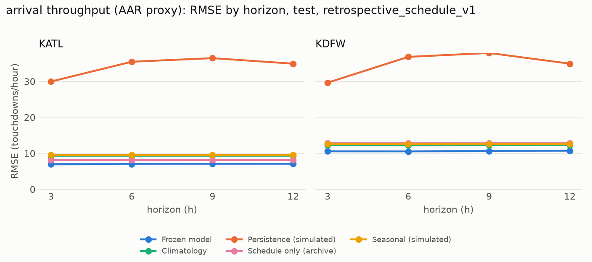

# Locked 2025 assessment

First frozen assessment: **2025-01-01 to 2025-08-01 exclusive**, with issue time at/after 2025-01-01 00:00 UTC. All comparisons below use real reporting-carrier data; this is historical assessment with simulated availability, not evidence of live operational performance. No model, feature, cohort, calibration or threshold was changed in response to these results.

## What the results mean

The frozen models have lower point arrival error and better severe-delay ranking than the tested baselines at both airports. Mean absolute arrival error is **4.60/hour at ATL and 7.11/hour at DFW**, versus the lowest baseline MAE of **5.62 and 7.97** on identical common support. Delay average precision is **0.241 / 0.263**, versus **0.206 / 0.219** for logistic regression. Average precision is a ranking measure, not percent accuracy.

The all-BTS model also performs better on the identical CSV subset than training only on the CSV sample. CSV-only training is not consistently better than the logistic baseline. Airport-transfer models beat the source-fitted schedule comparator but remain less accurate than local models on their respective supports.

**Operational reliability is still limited.** Thunderstorm-hour arrival RMSE rises to **14.78 at ATL and 20.99 at DFW**. The nominal 80% arrival interval covers **79.0% / 70.7%** on the common test rows. The frozen DFW delay Watch precision is **24.2%**, below its 30% target; its arrival Act event precision is **42.4%**, below the 50% calibration target. These failures are retained without threshold changes. The results support forecasting research and human review, not autonomous operational control.

## Arrival throughput (AAR proxy)

RMSE and MAE are touchdowns/hour; lower is better. Brackets are 95% operational-day block-bootstrap intervals (1,000 resamples; 08:00 UTC day anchor). Each airport comparison uses identical common-support rows, pooled over the four horizons.

| Airport | Model | RMSE [95% CI] | MAE | Common-support prediction rows |
|---|---|---:|---:|---:|
| KATL | lgbm_release_reporting_carrier_touchdowns_v1_calibrated | 7.035 [6.394, 7.739] | 4.600 | 20,235 |
| KATL | baseline_climatology_v1 | 9.328 [8.573, 10.246] | 6.417 | 20,235 |
| KATL | baseline_schedule_v1 | 8.165 [7.589, 8.864] | 5.621 | 20,235 |
| KATL | baseline_seasonal_persistence_v1 | 9.545 [8.694, 10.372] | 6.043 | 20,235 |
| KATL | baseline_persistence_v1 | 34.284 [33.935, 34.628] | 29.018 | 20,235 |
| KDFW | lgbm_release_reporting_carrier_touchdowns_v1_calibrated | 10.603 [10.093, 11.199] | 7.112 | 20,206 |
| KDFW | baseline_climatology_v1 | 12.256 [11.791, 12.760] | 8.572 | 20,206 |
| KDFW | baseline_schedule_v1 | 12.818 [12.366, 13.329] | 9.673 | 20,206 |
| KDFW | baseline_seasonal_persistence_v1 | 12.561 [11.480, 13.643] | 7.969 | 20,206 |
| KDFW | baseline_persistence_v1 | 34.955 [34.546, 35.331] | 29.182 | 20,206 |

## Severe departure delay

Positive means departure delay strictly over 45 minutes, conditional on operating. Cancelled flights are excluded. Average precision (AP) is higher-is-better; Brier is lower-is-better. Candidates use the calibration frozen from eligible H2 2024 outcomes; baseline probabilities retain their declared 2023 fits. AP confidence intervals are not implemented.

| Airport | Model | AP | Brier [95% CI] | Prevalence | Common-support prediction rows |
|---|---|---:|---:|---:|---:|
| KATL | lgbm_release_departure_delay_gt45_v1_calibrated | 0.2410 | 0.1010 [0.0925, 0.1101] | 12.18% | 713,434 |
| KATL | baseline_conditional_rate_v1 | 0.1717 | 0.1062 [0.0961, 0.1172] | 12.18% | 713,434 |
| KATL | baseline_logistic_v1 | 0.2064 | 0.1040 [0.0946, 0.1141] | 12.18% | 713,434 |
| KDFW | lgbm_release_departure_delay_gt45_v1_calibrated | 0.2627 | 0.1181 [0.1100, 0.1261] | 14.65% | 714,320 |
| KDFW | baseline_conditional_rate_v1 | 0.1926 | 0.1238 [0.1139, 0.1335] | 14.65% | 714,320 |
| KDFW | baseline_logistic_v1 | 0.2188 | 0.1220 [0.1127, 0.1313] | 14.65% | 714,320 |

## Cancellation companion

Cancellation is a separate outcome, not a negative severe-delay example.

| Airport | Model | Brier [95% CI] | Cancellation prevalence | Common-support prediction rows |
|---|---|---:|---:|---:|
| KATL | lgbm_release_cancellation_v1_calibrated | 0.0154 [0.0095, 0.0240] | 1.56% | 724,749 |
| KATL | baseline_conditional_rate_v1 | 0.0154 [0.0092, 0.0246] | 1.56% | 724,749 |
| KATL | baseline_logistic_v1 | 0.0154 [0.0092, 0.0245] | 1.56% | 724,749 |
| KDFW | lgbm_release_cancellation_v1_calibrated | 0.0315 [0.0217, 0.0433] | 3.32% | 738,876 |
| KDFW | baseline_conditional_rate_v1 | 0.0324 [0.0220, 0.0447] | 3.32% | 738,876 |
| KDFW | baseline_logistic_v1 | 0.0323 [0.0221, 0.0443] | 3.32% | 738,876 |

## Provided-CSV comparison

All models below score identical CSV sample-member requests. The true CSV model fits/selects/calibrates on sample members only. The paired all-BTS model reuses the frozen primary booster and primary calibration; it is not a CSV-only fit. The sparse CSV cannot support airport-hour throughput counts. Its cancellation baseline companion is reported separately in the full JSON.

| Airport | Model | AP | Brier [95% CI] | Prevalence | Common-support prediction rows |
|---|---|---:|---:|---:|---:|
| KATL | lgbm_release_departure_delay_gt45_v1_calibrated | 0.2459 | 0.1060 [0.0924, 0.1202] | 12.85% | 7,025 |
| KATL | lgbm_release_all_bts_on_csv_v1 | 0.3137 | 0.1020 [0.0892, 0.1153] | 12.85% | 7,025 |
| KATL | baseline_conditional_rate_v1 | 0.2056 | 0.1115 [0.0961, 0.1282] | 12.85% | 7,025 |
| KATL | baseline_logistic_v1 | 0.2555 | 0.1078 [0.0930, 0.1228] | 12.85% | 7,025 |
| KDFW | lgbm_release_departure_delay_gt45_v1_calibrated | 0.2296 | 0.1221 [0.1080, 0.1365] | 14.84% | 7,088 |
| KDFW | lgbm_release_all_bts_on_csv_v1 | 0.2773 | 0.1186 [0.1057, 0.1321] | 14.84% | 7,088 |
| KDFW | baseline_conditional_rate_v1 | 0.1956 | 0.1252 [0.1097, 0.1411] | 14.84% | 7,088 |
| KDFW | baseline_logistic_v1 | 0.2064 | 0.1248 [0.1101, 0.1404] | 14.84% | 7,088 |

## Airport holdouts

Train/select only on the other airport. No held-out fitting, categories, schedule normalizer, calibration or capacity ratio is used. Quantile intervals are raw in these transfer runs.

| Held-out airport | Model | RMSE [95% CI] | Common-support prediction rows |
|---|---|---:|---:|
| KATL | lgbm_release_reporting_carrier_touchdowns_v1 | 8.529 [8.100, 9.025] | 20,243 |
| KATL | baseline_transfer_schedule_v1 | 9.061 [8.670, 9.549] | 20,243 |
| KATL | baseline_persistence_v1 | 34.284 [33.933, 34.626] | 20,243 |
| KDFW | lgbm_release_reporting_carrier_touchdowns_v1 | 12.128 [11.636, 12.711] | 20,242 |
| KDFW | baseline_transfer_schedule_v1 | 13.708 [13.148, 14.367] | 20,242 |
| KDFW | baseline_persistence_v1 | 34.966 [34.551, 35.341] | 20,242 |

## Coverage and adverse weather

Rows repeat airport-hours or flights over 3/6/9/12-hour horizons; counts below are prediction rows, not unique flights. Scores exclude missing/ineligible outcomes and use common support for comparisons. Candidate availability is shown on its own eligible rows so abstention is not hidden. No unvalidated degraded candidate is scored.

| Target | Airport | Eligible rows | Candidate predictions | Candidate availability | Excluded outcome rows |
|---|---|---:|---:|---:|---:|
| reporting_carrier_touchdowns | KATL | 20,314 | 20,250 | 99.68% | 8 |
| reporting_carrier_touchdowns | KDFW | 20,290 | 20,274 | 99.92% | 32 |
| departure_delay_gt45 | KATL | 715,684 | 713,434 | 99.69% | 11,624 |
| departure_delay_gt45 | KDFW | 715,008 | 714,320 | 99.90% | 24,584 |
| cancellation | KATL | 727,308 | 724,749 | 99.65% | 0 |
| cancellation | KDFW | 739,592 | 738,876 | 99.90% | 0 |

Target-hour weather slices are evaluation-only; non-thunderstorm is not synonymous with clear weather. Sparse slices have wider uncertainty.

| Airport | Weather slice | Candidate RMSE [95% CI] | Prediction rows |
|---|---|---:|---:|
| KATL | weather:thunderstorm | 14.775 [11.800, 17.834] | 524 |
| KATL | weather:not_thunderstorm | 6.710 [6.086, 7.438] | 19,699 |
| KATL | weather:ifr | 11.012 [8.059, 14.210] | 1,738 |
| KATL | weather:not_ifr | 6.539 [6.086, 7.054] | 18,485 |
| KDFW | weather:thunderstorm | 20.985 [16.529, 25.047] | 468 |
| KDFW | weather:not_thunderstorm | 10.234 [9.807, 10.763] | 19,722 |
| KDFW | weather:ifr | 15.009 [11.482, 18.861] | 1,332 |
| KDFW | weather:not_ifr | 10.225 [9.865, 10.656] | 18,858 |

## Frozen intervals and operating thresholds

The 80% arrival interval has test coverage of 79.0% at ATL and 70.7% at DFW on the primary common support. DFW uncertainty is therefore too narrow for the nominal target; intervals were not widened after inspecting these results.

The table below applies the already-frozen WP-D7 rules to the same saved predictions. It is a read-only descriptive summary, not another model fit or a threshold search. Counts use candidate own support and repeat targets across four horizons. Act and Watch are mutually exclusive. Arrival events mean actual throughput below 70% of the train-only reference; low demand can cause such an event.

| Target | Airport | Level | Prediction rows | Alerts | Alert fraction | Precision | Recall |
|---|---|---|---:|---:|---:|---:|---:|
| reporting_carrier_touchdowns | KATL | act | 20,250 | 13,890 | 68.6% | 59.6% | 95.3% |
| reporting_carrier_touchdowns | KATL | watch | 20,250 | 2,594 | 12.8% | 9.4% | 2.8% |
| reporting_carrier_touchdowns | KDFW | act | 20,274 | 14,188 | 70.0% | 42.4% | 86.4% |
| reporting_carrier_touchdowns | KDFW | watch | 20,274 | 646 | 3.2% | 24.9% | 2.3% |
| departure_delay_gt45 | KATL | act (disabled) | 713,434 | 0 | n/a | n/a | n/a |
| departure_delay_gt45 | KATL | watch (disabled) | 713,434 | 0 | n/a | n/a | n/a |
| departure_delay_gt45 | KDFW | act (disabled) | 714,320 | 0 | n/a | n/a | n/a |
| departure_delay_gt45 | KDFW | watch | 714,320 | 246,485 | 34.5% | 24.2% | 57.1% |

Severe-delay Act is disabled at both airports and Watch is disabled at ATL because calibration did not reach the chosen precision targets. DFW Watch uses the frozen probability threshold 0.142105; its test precision misses 30%. Arrival Act flags roughly 69-70% of available prediction rows, so it should not be described as a selective detector of capacity disruption. The complete rule/hash record is [phase6_alerts.json](phase6_alerts.json).

## Three largest arrival misses

Chosen by the frozen evaluator, with distinct airport-days. These are retained even if they undermine the product story. Rule-based source explanations are in the corresponding failure-case JSON; they do not assert causality.

| Airport | Issue time (UTC) | Horizon | Target hour (UTC) | Forecast | Actual | Absolute error |
|---|---|---:|---|---:|---:|---:|
| KDFW | 2025-01-09T16:00:00Z | 9h | 2025-01-10T01:00:00Z | 66.6 | 0 | 66.6 |
| KATL | 2025-01-10T01:00:00Z | 12h | 2025-01-10T13:00:00Z | 76.1 | 16 | 60.1 |
| KDFW | 2025-07-12T12:00:00Z | 12h | 2025-07-13T00:00:00Z | 59.9 | 0 | 59.9 |

## Release record and interpretation

- The source of truth is [the sealed release](phase6_release.json), with fixed models, baseline fits, calibration, configuration and input-file fingerprints.
- Clean model fitting used commit `8e94877`; the sealed inference/evaluation protocol used `7f6c1b3`. The later protocol fixes did not change fitted weights.
- The batch claim preceded any test outcomes; each experiment has a separate immutable semantic prediction claim under [locked_runs](locked_runs/). No second assessment or test-guided refit was performed.
- The effective cutoff covers selection and calibration. Forecasts issued before 2025-01-01 are excluded even when their target falls inside the nominal test window. Calibration used only H2 2024 labels whose simulated outcome availability was at/before that cutoff.
- Primary scoring uses frozen label version 0.4.0, with explicit simulated availability. The earlier development dashboard models and reports remain historical artifacts; their different fit/availability protocols are not silently relabelled as these release models.
- The targets cover reporting-carrier flights; arrivals reflect demand as well as capacity. Earlier schedule-only analysis identified ATL source/volume drift in 2025. This assessment did not tune against it.
- Separate audits were omitted under the prior lead instruction. Implementation checks, four real 2024 inference smoke paths and all 609 tests passed before the release was claimed.
- Baseline/candidate gaps and overlapping confidence intervals should not be treated as a statistical significance claim. The CSV sample is sparse; this historical result does not certify live airport use.
- Optional operations-feed and capacity-ratio model experiments were not included in this final batch.

Full reports: [primary](metrics.json), [CSV](metrics_csv_only.json), [ATL holdout](metrics_leave_out_KATL.json), [DFW holdout](metrics_leave_out_KDFW.json). Their figures, availability, per-horizon errors, reliability and failure cases remain available alongside the JSON.

Frozen boosters, native baseline fits, policies and the release manifest are packaged in [phase6_models.tar.gz](phase6_models.tar.gz). Large prediction tables remain in the local `artifacts/frozen_*` folders; their hashes are recorded in the metric reports.
